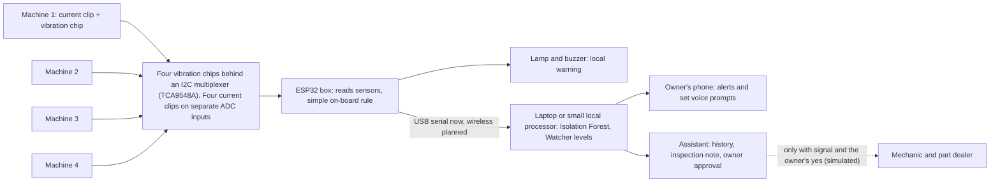

# Ramu Kaka

An inspection-support box and phone assistant for small workshops that run old machines. It tells the owner which machine to check and what a technician should inspect. It does not repair anything, does not name the broken part and does not give a failure date.

Team LogicXLoop (Sirjan Kaur, Gurman Gill, Avneet Kaur, Manpreet Kaur). Idea submission for Tech4Bharat 2026, problem statement 4.3: small factories lose production to breakdowns they cannot see coming.

Status: idea stage. The detector, simulator, assistant steps and tests run. We have not tested on a real motor, the firmware has not run on a board, and the voice and outside-contact parts are simulated. Each section below says what is done and what is not.

## The problem

In a small powerloom shed, flour mill or machine shop the owner is also the maintenance department. He judges a machine by sound and feel, nobody records past repairs, and when something fails he calls whichever mechanic is free. India has about 24.9 lakh powerlooms in about 3.86 lakh units (2013 baseline survey), so most units are small. Monitoring systems built for big plants do not fit them.

Machine sensors already exist. Presage Insights and Banner Engineering sell vibration and temperature sensors with dashboards, priced per machine, and Presage says small and mid-size plants can now afford it. Their prices are not public and we have not compared them with ours. Ecolibrium sells energy analytics to large industries and buildings. Verdigris puts one sensor on an electrical panel, mainly for large buildings and hotels. Our aim is narrower: one low-cost box that watches up to four machines, keeps working with no internet, and gives the owner a plain "check this machine" with a technician's inspection note. We do not claim that any one of these ideas is new. The combination for the smallest workshops is what we want to test.

## Architecture



Who does what. The ESP32 reads the sensors, prints one line of numbers per window and runs a simple far-from-normal rule that drives the lamp and buzzer, so a local warning works with no laptop or phone. The full model runs on a laptop or small local processor. The phone shows alerts and talks to the owner with set voice prompts. The internet is used only for outside steps. In this repo the phone is a text interface that stands in for the app, which is not built.

## Components for a four-machine box

| Part | Qty | Price each | Role | Status |
|---|---|---|---|---|
| ESP32 board | 1 | about Rs 405 | Reads sensors, on-board warning, sends readings | Firmware written for one machine, never run on a board |
| SCT-013 clip-on current sensor | 4 | about Rs 411 | Running or idle, load, electrical trouble | Not tested |
| MPU6050 vibration chip | 4 | about Rs 141 | Looseness, imbalance, rough running | Its bandwidth is about 260 Hz, so it may miss early bearing wear |
| I2C multiplexer (for example TCA9548A) | 1 | not priced yet | The MPU6050 has only two I2C addresses, so four on one bus need it | Not built |
| ADC for four current channels | 1 | not priced yet | The ESP32's own ADC is noisy and nonlinear. Options: ADC1 pins, or an ADS1115 | Not decided |
| Lamp and buzzer | 1 | not priced yet | Local warning | In the firmware |
| Laptop or small local processor | 1 | not included | Runs the full model | A laptop in the first prototype |

The priced parts add up to about Rs 2,613 (405 + 4 x 411 + 4 x 141, hobby-shop prices). That leaves out the multiplexer, the ADC, the case, cables, power supply and the laptop. Our assumed selling price of Rs 5,000 per four-machine box is an assumption and has not been tested with owners.

## AI methodology

The detector (`ramukaka/detector.py`) learns what normal looks like for each machine and never sees a fault while learning. It works in three layers.

| Layer | What it does |
|---|---|
| 1. State | The current tells idle from running (below 0.5 A counts as idle). A heavy-load state is planned and not built. |
| 2. Compare with the baseline | Each machine has its own model for each state. A window is odd if an Isolation Forest (200 trees, contamination 0.01) finds it unusual, or if any one scaled number is more than 4 spreads from normal. The four numbers per window are current RMS, change in current, vibration RMS and vibration peak. |
| 3. Persistence | An alert comes only if the oddness lasts across several windows, so one noisy reading does nothing. |

The `Watcher` turns the last 6 windows into one of three levels.

| Level | Rule | Meaning |
|---|---|---|
| Normal | Fewer than 4 odd windows | Readings are within the baseline |
| Warning | 4 or more odd windows | Persistent deviation, keep watching |
| Inspect | All 6 windows odd | Sustained anomaly, a technician should check |

The limits 4 of 6 and 6 of 6 are our starting values. They have not been tested on a real machine and will be tuned in the prototype. The alert never names a broken part. It says which machine to check and what to look at, for example the mounting, alignment and bearings.

Calibration has two stages. Stage 1 is a lab motor: healthy readings under several operating conditions train a first baseline, then we apply controlled changes such as extra load or a loose mount. Stage 2 is real deployment: weeks of normal running, with the baseline updated only after verification and compared with a technician's observations. The Python code never retrains on its own and never learns from data flagged as suspicious. One more point: the firmware learns its own simple baseline from the first 2000 windows after power-up, about half an hour, so it must be started while the machine is healthy.

## Agent workflow

| Step | What happens | Needs signal | Owner's yes |
|---|---|---|---|
| 1. Detect | The model raises Warning or Inspect for one machine | No | No |
| 2. Alert | Lamp and buzzer on the box, message on the phone | Phone link only | No |
| 3. Add context | A worker's voice note is attached to the machine's history. The first prototype uses set prompts. | No | No |
| 4. Plan | The assistant picks a quiet hour from the idle windows and writes an inspection note | No | No |
| 5. Ask | It asks the owner before anything that costs money or stops production | No | Yes |
| 6. Contact | After the yes, it calls mechanics and dealers in order and moves to the next if one does not answer. Simulated in this repo. | Yes. Waits in a queue until signal returns | Already given |
| 7. Record | The outcome goes into the machine's history | No | No |

Offline mode covers sensor monitoring, local alerts, machine history and basic inspection suggestions. Connected mode adds mechanic contact, parts inquiries and notifications. Nothing goes out without the owner's yes.

## Evidence so far

`experiments/cwru_validation.py` runs the same two checks as the detector (Isolation Forest plus the far-from-normal check) on the Case Western Reserve University bearing data, which is real vibration recorded on a lab test rig. It is a separate script. It uses three vibration numbers per window (RMS, peak and kurtosis, 2048 samples at 12 kHz), not the four numbers of the full detector, and it counts odd windows one by one, without the 4-of-6 rule. The output is saved in `experiments/cwru_results.txt`.

Set-up: the four normal recordings (motor loads 0 to 3) are each split in time. The first 70% of every recording trains the model and the last 30% is held out. Faulty recordings are never shown to the model. The Isolation Forest uses 300 trees, contamination 0.01 and random_state 0.

| Test | Result |
|---|---|
| Held-out normal windows flagged by mistake | 2.0% |
| Fault windows flagged (ball, inner race, outer race, all sizes in the data) | 100% |
| One motor load left out of the learning, normal windows flagged by mistake | 28.6% (load 0), 1.7% (load 1), 1.7% (load 2), 0.8% (load 3) |

Do not read this as the accuracy we will get. The faults in that data were cut into the bearings on purpose and shake 2 to 10 times harder than a healthy bearing. Early wear in a workshop will be much harder to see. The rig has no current sensor, so only vibration was used. The 29% result is a real limit: if a machine runs at a load the box never saw while learning, it can raise false alarms, so the baseline has to cover the loads we expect. A 2025 low-cost ESP32 study reached about 73%, and we expect to land nearer that than to 100%.

To reproduce, download the CWRU data from the Case Western Reserve University Bearing Data Center (or clone a copy such as `XiongMeijing/CWRU-1`). The script expects a `Normal` folder and a `12k_DE` folder of `.mat` files inside the folder you point it at. We did not copy the data into this repo. We last ran it with numpy 2.5, scipy 1.18 and scikit-learn 1.9.

## What works and what does not

| Item | Status |
|---|---|
| Detector, simulator, assistant steps, alert levels | Work. 7 tests pass |
| CWRU real-data check | Done, with the caveats above |
| Real motor test | Not done. The demo uses made-up data, so its numbers only show that the code runs |
| Firmware | Written for one machine, never run on a board |
| Four machines on one board | Needs the multiplexer. Not built and not in the price estimate |
| Wireless link from box to laptop | Not built. The firmware prints over USB serial |
| Phone app and voice prompts | Not built. A text interface stands in |
| Speech recognition in Indian languages | Not built. A 2026 benchmark by Josh Talks and AI4Bharat reported high error for some global models on Indian speech |
| Calls to mechanics and dealers, payment | Simulated |
| Testing plan (recall, false-alarm rate, alert delay, uptime) | Not run yet. Precision and F1 need properly labelled data we do not have |
| Running cost of the assistant | Unknown |

## Implementation roadmap

| Phase | Work | Output |
|---|---|---|
| 1. Prototype on one small motor (23 Nov to 15 Dec 2026, if shortlisted) | Wire one box. Record normal running, then extra load and a loose mount. Replace the USB cable with a wireless link | Recall, false-alarm rate, alert delay and uptime measured and reported, including what the box misses |
| 2. Four-machine build | Add the multiplexer and four current channels. Check the Rs 2,613 estimate against real prices | Working four-machine box and a full cost list |
| 3. Phone and voice | Phone app with set voice prompts, and a queue for outside actions. Later, test an Indian-language speech model | Owner can see alerts and answer yes or no by voice |
| 4. Real workshop | With the owner's permission, weeks of normal running on one real machine. Update the baseline only after verification, tune the limits, talk to owners about price | Stage 2 calibration results and a tested price |

## Run it

```
pip install -r requirements.txt
python -m ramukaka.demo
python -m pytest
```

## References

| Source | Used for | Link |
|---|---|---|
| Low-cost ESP32 anomaly detection with Isolation Forest (MDPI Sensors, 2025) | Same chip class and method, about 73% in a lab | https://www.mdpi.com/1424-8220/25/21/6610 |
| Low-cost stator current sensing with ESP32 | Current sensing on an ESP32 | https://pmc.ncbi.nlm.nih.gov/articles/PMC6719952 |
| Vibration versus stator current for bearing faults | Why we add vibration to current | https://scispace.com/pdf/comparison-between-vibration-and-stator-current-analysis-for-28len2750p.pdf |
| Electric motor failure statistics (Reliability magazine) | Bearings cause 41% to 60% of failures in surveys of large motors | https://reliamag.com/topics/guides/electric-motor-failure-statistics |
| MIMII machine sound dataset | Why we use contact sensing, not a microphone. External research, not our result | https://github.com/BA-HanseML/NF_Prj_MIMII_Dataset |
| Voice of India speech benchmark | Speech risk on Indian languages | https://analyticsindiamag.com/ai-news/ai4bharat-josh-talks-benchmark-flags-55-error-rate-for-openai-in-indian-speech |
| Single-point fault detection on ships (MIT) | Later research idea, not promised | https://emsg.mit.edu/wp-content/uploads/2024/12/Dashboard_Nonintrusive_Electromechanical_Fault_Detection_and_Diagnostics.pdf |
| Load disaggregation for textile motors | Later research idea, not promised | https://arxiv.org/html/2601.01616v1 |
| CWRU Bearing Data Center | Real-data check | https://engineering.case.edu/bearingdatacenter |

## Credits and licence

The reference photos in our deck are from Akul Verma's motor test bench on ElectronicWings (Apache-2.0). Licence for this repo: MIT.
